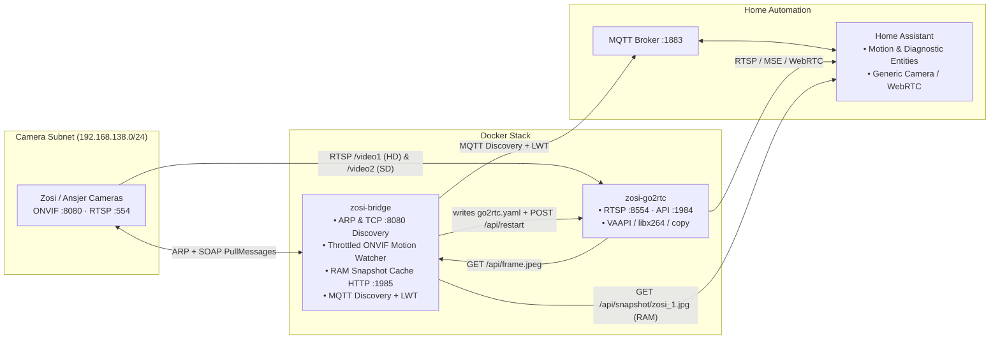

# Zosi Home Assistant Bridge (`zosi-ha-bridge`)

<p align="left">
  
  
  
  
  
  <a href="LICENSE"></a>
</p>

Auto-discovery, [`go2rtc`](https://github.com/AlexxIT/go2rtc) stream synchronization, in-memory RAM snapshot caching, and ONVIF-to-MQTT motion bridge for **Zosi / Ansjer IP cameras** in **Home Assistant**.

> [!WARNING]
> **Vibe-Coded Disclaimer**
>
> This project was **vibe-coded with AI assistance** to solve a real-world homelab setup with Zosi/Ansjer PoE cameras. While the codebase has been refactored, bug-hunted, and tested (including an offline unit test suite), it is provided **as-is** without any warranty.
> Please review the Docker Compose networking (`macvlan`), firewall rules, and environment variables before running it in your own environment — especially since Zosi kit cameras expose **unauthenticated** ONVIF (`:8080`) and RTSP (`:554`) services on their local camera segment.

---

## Why This Exists

Zosi NVR kit cameras (Ansjer OEM firmware) typically live on an isolated camera subnet (`192.168.138.0/24`) and:
- Do **not** have a built-in Home Assistant integration
- Stream **HEVC (H.265)** + **PCM A-law** audio, which breaks WebRTC/MSE playback in many browsers without transcoding
- Ignore ONVIF `PullMessages` long-poll timeouts (`PT10S`) and reply immediately, causing naive pollers to hammer the camera CPU
- Have no working HTTP JPEG snapshot endpoint (often returning HTTP `500`), forcing slow cold RTSP/FFmpeg pulls every time a dashboard loads

`zosi-ha-bridge` solves all of this in one lightweight container alongside `go2rtc`.

---

## Key Features

- **Zero-Touch Discovery**: Combines raw `AF_PACKET` ARP scanning with concurrent TCP `:8080` probing and ONVIF `GetDeviceInformation` / `GetNetworkInterfaces`. Assigns deterministic IDs (`zosi_1`, `zosi_2`, …) sorted by MAC address so DHCP/IP changes never break Home Assistant entities.
- **Intel/AMD VAAPI + Low-Latency `go2rtc` Sync**: Automatically generates `go2rtc.yaml` with configurable `TRANSCODE_MODE` (`vaapi`, `libx264`, or `copy`) and fast FFmpeg probe flags (`-fflags nobuffer -flags low_delay -probesize 150000 -analyzeduration 100000`), reloading `go2rtc` cleanly via `/api/restart`.
- **In-Memory RAM Snapshot Cache (`:1985`)**: Serves `/api/snapshot/<cam_id>.jpg` directly from RAM in milliseconds using *stale-while-revalidate* (`SNAPSHOT_CACHE_TTL`), staggered background refreshes (avoiding concurrent camera bursts), and instant async refreshes when motion triggers.
- **Throttled ONVIF Motion Watcher**: Subscribes to `CellMotionDetector/Motion` via ONVIF `PullPointSubscription` with configurable `MOTION_POLL_INTERVAL` (prevents tight poll loops) and optional `MOTION_OFF_DELAY` debounce hold.
- **Home Assistant MQTT Auto-Discovery + LWT**: Publishes `binary_sensor.<id>_motion`, `sensor.<id>_ip`, and `sensor.<id>_firmware` with `availability_mode: "all"` (`zosi/bridge/status` + `zosi/<id>/status`) and automatic re-discovery when `homeassistant/status` reports `online`.

---

## Architecture



---

## Repository Structure

```text
zosi-ha-bridge/
├── docker/
│   ├── Dockerfile                   # Multi-module container build (python:3.12-slim)
│   └── docker-compose.example.yml   # zosi-bridge + zosi-go2rtc stack with macvlan & VAAPI
├── scripts/
│   └── zosi                         # Helper CLI wrapper (status, discover, snapshot, health, logs)
├── src/zosi_bridge/
│   ├── cli.py                       # Argument parsing, env validation & subcommands
│   ├── go2rtc_config.py             # go2rtc.yaml renderer (vaapi/libx264/copy) & reload helper
│   ├── models.py                    # Camera dataclass, MAC validation & thread-safe atomic writes
│   ├── mqtt_bridge.py               # Daemon orchestrator, HA MQTT discovery & LWT
│   ├── network.py                   # AF_PACKET ARP scan, TCP :8080 probe & dynamic IP exclusions
│   ├── onvif.py                     # Hardened SOAP client, camera discovery & MotionWatcher
│   └── snapshot_cache.py            # RAM JPEG cache (SWR) & HTTP server (:1985)
├── tests/                           # Offline unittest suite (mocked sockets/HTTP/SOAP/MQTT)
├── .env.example                     # Sample environment configuration
├── pyproject.toml                   # Package metadata & zosi-bridge entrypoint
└── LICENSE                          # MIT License
```

---

## Prerequisites

1. **Linux host with Docker & Docker Compose** connected to the camera Layer-2 network (dedicated NIC or VLAN).
2. **Docker `macvlan` network** for the camera subnet (default `192.168.138.0/24`):
   ```bash
   docker network create -d macvlan \
     --subnet=192.168.138.0/24 \
     --gateway=192.168.138.1 \
     -o parent=eth0 \
     zosi_net
   ```
   *(Replace `eth0` with the interface or VLAN sub-interface facing your cameras.)*
3. **MQTT Broker** (e.g., Eclipse Mosquitto) wired into Home Assistant.
4. *(Optional)* **VAAPI device** (`/dev/dri/renderD128`) passed into `zosi-go2rtc` for hardware H.264 transcoding.

---

## Quick Start

1. **Clone the repository and configure `.env`**:
   ```bash
   git clone https://github.com/jente509/zosi-ha-bridge.git
   cd zosi-ha-bridge
   cp .env.example .env
   ```
   Adjust `MQTT_HOST`, `SUBNET`, `EXCLUDE_IPS`, and `TRANSCODE_MODE` in `.env`.
   If using Intel/AMD VAAPI, uncomment the `devices: ["/dev/dri:/dev/dri"]` section in [`docker/docker-compose.example.yml`](docker/docker-compose.example.yml).

2. **Start the containers**:
   ```bash
   mkdir -p docker/data docker/go2rtc
   docker compose -f docker/docker-compose.example.yml up -d --build
   ```

3. **Verify discovery, health, and RAM snapshots**:
   ```bash
   ./scripts/zosi status
   ./scripts/zosi health
   ./scripts/zosi snapshot 1 cam1.jpg
   ```

---

## Configuration Reference

All options can be set via environment variables (see [`.env.example`](.env.example)) or CLI flags:

| Variable | Default | Description |
| --- | --- | --- |
| `SUBNET` | `192.168.138.0/24` | IPv4 CIDR subnet to scan for Zosi cameras |
| `EXCLUDE_IPS` | `""` | Comma-separated IPs to skip (bridge & `GO2RTC_URL` IPs are also auto-excluded) |
| `DISCOVER_INTERVAL` | `300` | Seconds between periodic camera discovery runs |
| `ONVIF_PORT` / `RTSP_PORT` | `8080` / `554` | Camera ONVIF and RTSP ports |
| `GO2RTC_URL` | `http://zosi-go2rtc:1984` | `go2rtc` API base URL for config reload & frame grabs |
| `TRANSCODE_MODE` | `vaapi` | Stream transcode mode: `vaapi`, `libx264`, or `copy` |
| `VAAPI_DEVICE` | `/dev/dri/renderD128` | Render node passed to `ffmpeg.global` when `TRANSCODE_MODE=vaapi` |
| `MQTT_HOST` / `MQTT_PORT` | `host.docker.internal` / `1883` | MQTT broker host and port |
| `MQTT_USER` / `MQTT_PASSWORD` | `""` | Optional MQTT credentials |
| `MOTION_POLL_INTERVAL` | `1.5` | Minimum cycle interval (seconds) per camera for ONVIF `PullMessages` |
| `MOTION_OFF_DELAY` | `0.0` | Optional hold delay (seconds) before transitioning `ON` → `OFF` |
| `SNAPSHOT_SERVER_PORT` | `1985` | RAM snapshot HTTP server port (`0` disables) |
| `SNAPSHOT_CACHE_TTL` | `10.0` | Freshness window (seconds) before background stale-while-revalidate refresh |

---

## Home Assistant Integration

### 1. MQTT Entities (Automatic)
Once `zosi-bridge` connects to MQTT, Home Assistant automatically discovers per camera:

| Entity | State Topic | Purpose |
| --- | --- | --- |
| `binary_sensor.zosi_<n>_motion` | `zosi/zosi_<n>/motion` | Motion state (`ON` / `OFF`) |
| `sensor.zosi_<n>_ip` | `zosi/zosi_<n>/ip` | Current camera IPv4 address |
| `sensor.zosi_<n>_firmware` | `zosi/zosi_<n>/firmware` | Reported camera firmware version |

Availability uses `availability_mode: "all"` combining `zosi/bridge/status` (with MQTT Last Will) and `zosi/zosi_<n>/status`.

### 2. Camera Feeds & Fast Snapshots
Add each camera in Home Assistant using **Generic Camera** (or connect `go2rtc` directly):

- **Stream Source (H.264 + AAC)**: `rtsp://127.0.0.1:8554/zosi_1` *(or `zosi_1_hd` / `zosi_1_sd` for raw HEVC)*
- **Still Image URL (RAM-cached JPEG)**: `http://127.0.0.1:1985/api/snapshot/zosi_1.jpg`

### HTTP Endpoints (`:1985`)
- `GET /api/snapshot/<cam_id>.jpg` — Returns RAM-cached JPEG (with startup pre-warming, `ETag` + `If-None-Match` `304 Not Modified`, `X-Cache` `HIT`/`STALE`/`MISS`, and `X-Snapshot-Age` headers).
- `GET /health` — JSON bridge status (`cameras_total`, `cameras_online`, `cached_snapshots`, `cache_stats`, `mqtt_connected`, `motion_states`).
- `GET /api/cameras` — Full camera inventory with per-camera snapshot cache metadata (`snapshot_fetch_ms`, `snapshot_etag`, `snapshot_age_seconds`).

---

## Performance & Tuning Notes

| Mode | Video Codec | Host CPU | Notes |
| --- | --- | --- | --- |
| `vaapi` *(default)* | H.264 (hardware) | Very Low | Requires `/dev/dri:/dev/dri` on `zosi-go2rtc`. Sets `ffmpeg.global: -vaapi_device ...`. |
| `libx264` | H.264 (software) | High | Fallback when no iGPU/GPU is available. |
| `copy` | Original (`HEVC`) | Minimal | Only transcodes audio to AAC (`#video=copy#audio=aac`). Requires HEVC-capable clients. |

> [!TIP]
> Keeping 24/7 continuous `preload` active on many 2K HEVC streams simultaneously can consume substantial CPU/network bandwidth on both the host and cameras. The built-in staggered **RAM snapshot cache** gives near-instant dashboard thumbnails without keeping video encoders running when nobody is watching.

---

## CLI & Development

```bash
# Run CLI directly
python3 -m zosi_bridge discover --subnet 192.168.138.0/24 --transcode-mode vaapi --reload
python3 -m zosi_bridge status --live
python3 -m zosi_bridge daemon

# Or use the helper script
./scripts/zosi health
./scripts/zosi cameras
./scripts/zosi logs 100

# Run the offline unit test suite
python3 -m unittest discover -s tests -v
```

<details>
<summary><strong>Troubleshooting</strong></summary>

- **ARP scan logs `Operation not permitted`**: Ensure `cap_add: [NET_RAW]` is present on `zosi-bridge`. TCP `:8080` scanning still works as a fallback.
- **VAAPI errors in `zosi-go2rtc`**: Verify `/dev/dri:/dev/dri` is mounted on `zosi-go2rtc` and `VAAPI_DEVICE` matches your render node (`/dev/dri/renderD128`). Otherwise switch `TRANSCODE_MODE=copy` or `libx264`.
- **`/api/snapshot/...` returns `503`**: Check `./scripts/zosi cameras` for `snapshot_error` and ensure `zosi-go2rtc` is reachable at `GO2RTC_URL`.
- **Entities show `unavailable` in Home Assistant**: Inspect `zosi/bridge/status` and `zosi/zosi_<n>/status` on your MQTT broker and verify `MQTT_HOST:MQTT_PORT`.

</details>

---

## License

Released under the [MIT License](LICENSE).
