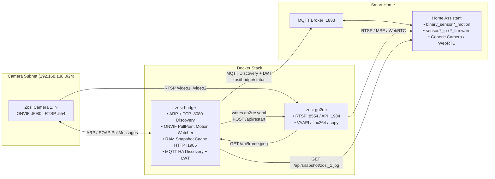

# Zosi Home Assistant Bridge (`zosi-ha-bridge`)

Auto-discovery, `go2rtc` stream synchronization, in-memory RAM snapshot caching, and ONVIF-to-MQTT motion bridge for Zosi / Ansjer IP cameras in Home Assistant.

Zosi NVR kit cameras typically operate on an isolated factory subnet (`192.168.138.0/24`) with unauthenticated ONVIF (`:8080`) and RTSP (`:554`) services, HEVC/H.265 main streams (`/video1`), and G.711 audio. `zosi-ha-bridge` bridges those cameras cleanly into Docker, `go2rtc`, and Home Assistant without requiring cloud services or manual per-camera YAML edits.

---

## Architecture



---

## Features

- **Zero-Touch Camera Discovery**: Combines raw `AF_PACKET` ARP scanning with concurrent TCP `:8080` probing and ONVIF `GetDeviceInformation` / `GetNetworkInterfaces` queries. Assigns deterministic IDs (`zosi_1`, `zosi_2`, ...) sorted by MAC address so IP changes never break Home Assistant entity IDs.
- **Dynamic IP Exclusions**: Automatically excludes the local bridge interface IP, auto-resolves the `GO2RTC_URL` hostname IP, and honors `EXCLUDE_IPS` / `--exclude-ips` instead of relying on hardcoded addresses.
- **Automatic `go2rtc.yaml` Management**: Atomically writes `go2rtc.yaml` (thread-safe tempfiles with `0644` permissions) and triggers `/api/restart` with retry backoff whenever cameras are added or change IPs.
- **Configurable Transcoding & Low-Latency Probe Flags**: Supports `vaapi`, `libx264`, and `copy` transcode modes with fast FFmpeg probe settings (`-fflags nobuffer -flags low_delay -probesize 150000 -analyzeduration 100000`).
- **Rate-Limited ONVIF Motion Watcher**: Uses ONVIF `PullPointSubscription` (`CellMotionDetector/Motion`) with configurable `MOTION_POLL_INTERVAL` (preventing tight poll loops on cameras that ignore `PT10S` long-poll timeouts) and optional `MOTION_OFF_DELAY` debounce hold.
- **MQTT Home Assistant Discovery + LWT**: Publishes MQTT Last Will & Testament (`zosi/bridge/status` = `offline`), camera availability (`zosi/<id>/status`), and Home Assistant discovery payloads with `availability_mode: "all"`. Re-publishes automatically when `homeassistant/status` announces `online`.
- **In-Memory RAM Snapshot Cache (`:1985`)**: Serves `/api/snapshot/<cam_id>.jpg` straight from RAM using stale-while-revalidate (`SNAPSHOT_CACHE_TTL`), staggered background refreshes (avoiding thundering-herd camera hits), and immediate asynchronous refreshes when motion triggers.

---

## Prerequisites

1. **Docker & Docker Compose** on a Linux host connected to the Zosi camera network (directly or via a dedicated VLAN/NIC).
2. **Docker `macvlan` network** (if your cameras sit on a separate Layer-2 segment such as `192.168.138.0/24`):
   ```bash
   docker network create -d macvlan \
     --subnet=192.168.138.0/24 \
     --gateway=192.168.138.1 \
     -o parent=eth0 \
     zosi_net
   ```
   *(Replace `eth0` with your camera-facing NIC or VLAN sub-interface.)*
3. **MQTT Broker** (e.g., Eclipse Mosquitto) connected to Home Assistant.
4. *(Optional)* **VAAPI device** (`/dev/dri/renderD128`) passed through to `zosi-go2rtc` for Intel/AMD hardware transcoding.

---

## Quick Start

1. **Clone and configure environment variables**:
   ```bash
   git clone https://github.com/jente509/zosi-ha-bridge.git
   cd zosi-ha-bridge
   cp .env.example .env
   ```
   Edit `.env` to match your MQTT broker, subnet, excluded IPs, and desired `TRANSCODE_MODE`.

2. **Start the stack**:
   ```bash
   mkdir -p docker/data docker/go2rtc
   docker compose -f docker/docker-compose.example.yml up -d --build
   ```

3. **Verify discovery and snapshot server**:
   ```bash
   ./scripts/zosi status
   ./scripts/zosi health
   ./scripts/zosi snapshot 1 test_cam1.jpg
   ```

---

## Home Assistant Integration

Once `zosi-bridge` connects to your MQTT broker, Home Assistant automatically discovers three entities per camera:

| Entity | Topic | Notes |
| --- | --- | --- |
| `binary_sensor.zosi_<n>_motion` | `zosi/zosi_<n>/motion` | `ON` / `OFF`, `device_class: motion` |
| `sensor.zosi_<n>_ip` | `zosi/zosi_<n>/ip` | Diagnostic IPv4 address |
| `sensor.zosi_<n>_firmware` | `zosi/zosi_<n>/firmware` | Diagnostic camera firmware version |

Availability requires **both** `zosi/bridge/status` and `zosi/zosi_<n>/status` to be `online` (`availability_mode: "all"`). If `zosi-bridge` stops unexpectedly, the MQTT broker publishes `offline` via LWT so entities become `unavailable` immediately.

### Live Streams & Cached Snapshots in Home Assistant

- **Low-latency RTSP stream (via `go2rtc`)**: `rtsp://127.0.0.1:8554/zosi_1` (or `zosi_1_hd` / `zosi_1_sd`)
- **go2rtc WebRTC / MSE**: Integrate `go2rtc` (`http://<host>:1984`) with the Home Assistant `go2rtc` / WebRTC Camera integration.
- **Fast RAM-cached JPEG snapshot (for dashboards & notifications)**:
  Use the **Generic Camera** integration or notification attachment URL pointing to:
  ```text
  http://127.0.0.1:1985/api/snapshot/zosi_1.jpg
  ```
  Responses include `X-Cache` (`HIT`, `STALE`, or `MISS`) and `X-Snapshot-Age` headers.

---

## Performance Tuning: VAAPI & RAM Snapshot Cache

### `TRANSCODE_MODE` (`vaapi` | `libx264` | `copy`)

| Mode | Video Codec | CPU Usage | Notes |
| --- | --- | --- | --- |
| `vaapi` *(default)* | H.264 via VAAPI | Very Low | Sets `ffmpeg.global: "-vaapi_device /dev/dri/renderD128"`. Requires `/dev/dri` device passthrough on `zosi-go2rtc`. |
| `libx264` | Software H.264 | High | Use if no GPU/iGPU is available and H.264 transcoding is needed. |
| `copy` | Pass-through (`HEVC`/`H.264`) | Minimal | Only transcodes audio to AAC (`#video=copy#audio=aac`). Ideal for modern browsers/apps supporting HEVC directly. |

All modes configure `ffmpeg.rtsp` with low-latency probe flags:
```text
-fflags nobuffer -flags low_delay -probesize 150000 -analyzeduration 100000
```

### ONVIF Motion Watcher Tuning

- `MOTION_POLL_INTERVAL` (default `1.5`s): Enforces a minimum cycle interval per camera. Many Zosi/Ansjer firmwares ignore the ONVIF `PT10S` pull timeout and reply in ~0.5s; enforcing `1.5`s keeps polling smooth at ~0.6 req/s per camera instead of hammering CPU and event loops.
- `MOTION_OFF_DELAY` (default `0.0`s): Optional hold time before transitioning `ON -> OFF`. Useful (e.g., `5.0`s) to prevent rapid motion sensor flickering.

### RAM Snapshot Cache Tuning

- `SNAPSHOT_SERVER_PORT` (default `1985`, `0` disables): Built-in HTTP server port.
- `SNAPSHOT_CACHE_TTL` (default `10.0`s): Maximum age for a `HIT`. Requests beyond TTL return the stale cached JPEG immediately (`X-Cache: STALE`) while refreshing asynchronously in the background.
- Staggered background refresh fetches online cameras sequentially with a short delay so `go2rtc` and cameras are never hit all at once.
- Motion `ON` events immediately trigger a deduplicated asynchronous snapshot refresh for that camera.

---

## CLI & Wrapper Usage

Run directly via Python module or inside the container:

```bash
# Discover cameras and update cameras.json + go2rtc.yaml
python3 -m zosi_bridge discover --subnet 192.168.138.0/24 --transcode-mode vaapi --reload

# Inspect current camera inventory (add --live to probe ONVIF/RTSP)
python3 -m zosi_bridge status --live

# Run full daemon
python3 -m zosi_bridge daemon
```

Or use the included helper wrapper [`scripts/zosi`](scripts/zosi):

```bash
./scripts/zosi discover
./scripts/zosi status
./scripts/zosi snapshot 1 cam1.jpg
./scripts/zosi health
./scripts/zosi cameras
./scripts/zosi logs 100
```

Override container names or endpoints via `ZOSI_BRIDGE_CONTAINER`, `ZOSI_GO2RTC_CONTAINER`, `ZOSI_SNAPSHOT_URL`, and `ZOSI_GO2RTC_URL`.

---

## Development & Testing

```bash
python3 -m unittest discover -s tests -v
```

All unit tests mock sockets, HTTP/SOAP responses, and MQTT clients so the full suite runs offline without live cameras.

---

## Troubleshooting

- **ARP scan logs `Operation not permitted`**: Ensure `cap_add: [NET_RAW]` is set on `zosi-bridge` in Docker Compose. TCP `:8080` scanning still works as a fallback.
- **VAAPI errors in `zosi-go2rtc`**: Verify `/dev/dri:/dev/dri` is mapped into `zosi-go2rtc` and `VAAPI_DEVICE` matches your host render node (usually `/dev/dri/renderD128`). Otherwise switch `TRANSCODE_MODE=copy` or `libx264`.
- **Snapshot endpoint returns `503`**: Confirm `zosi-go2rtc` is running and `GO2RTC_URL` is reachable from `zosi-bridge`. Check `/api/cameras` to inspect `snapshot_error` per camera.
- **Entities show `unavailable` in Home Assistant**: Check MQTT topics `zosi/bridge/status` and `zosi/zosi_<n>/status`, and ensure `zosi-bridge` can reach `MQTT_HOST:MQTT_PORT`.

---

## License

[MIT](LICENSE)
